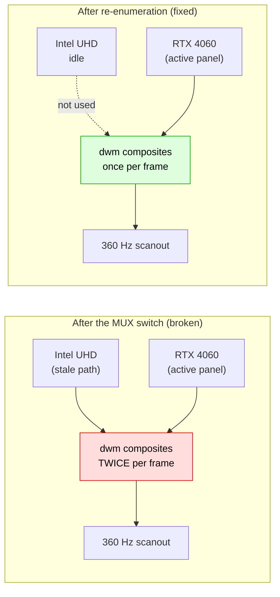

<div align="center">

# 🖥 When the MUX switch leaves Windows seeing **two monitors**

**One panel. Two display paths. Your typing arrives late.**

[](#)
[](#test-machine)
[](#)
[](#-the-40-second-fix)
[](LICENSE)

*A measured, evidence-backed explanation of a Windows display bug that shows up after
switching a gaming laptop from Optimus to "NVIDIA GPU only" — plus a fix you can run
in 40 seconds, forever.*

</div>

---

## 😵 The symptom

You switch the laptop's graphics mode from **Optimus (hybrid)** to **NVIDIA GPU only**
because you want the dGPU. The screen blanks for a second — normal. You reboot.

Then something is *off*, but nothing is broken:

- Typing feels laggy — a word appears **a moment after** you finished typing it
- Scrolling and window animations are not smooth, but they never freeze
- The mouse cursor feels slightly "behind"
- Task Manager shows **`dwm.exe` eating 30–46 % of a CPU core** while you are doing nothing
- Nothing crashes. No errors. Just no longer butter smooth

Most people give up here and switch back to Optimus, or reinstall Windows.

---

## ⚡ The 40-second fix

```powershell
powershell -ExecutionPolicy Bypass -File .\tools\fix-display-after-mux-switch.ps1
```

It will ask for admin once, blink the screen once, and take about 40 seconds.
No reboot. No driver reinstall. Nothing is uninstalled.

**Measured result on the test machine:**

| | Before | After |
|---|---|---|
| `dwm.exe` CPU (idle desktop) | **35 – 46 %** of one core | **0.2 %** |
| Active monitor devices | **2** | **1** |
| Display adapters doing 3D work | **2** | 1 |
| System stalls > 40 ms in 20 s | — | **0** |

Just want to look without touching anything?

```powershell
powershell -ExecutionPolicy Bypass -File .\tools\fix-display-after-mux-switch.ps1 -MeasureOnly
```

---

## 🔬 What is actually happening

Your laptop has a hardware **MUX** — a switch that physically rewires the internal
panel from the integrated GPU to the discrete GPU. Dell calls the modes
*Optimus* / *NVIDIA GPU only* (NVIDIA calls the automation *Advanced Optimus*).

When the panel moves to the other GPU, Windows is supposed to **retire the old display
path** and create one new one. On this machine it created the new one and **kept the
old one alive**.

Windows keeps a small database of which display is connected to which adapter:

```
HKLM\SYSTEM\CurrentControlSet\Control\GraphicsDrivers\Connectivity
```

On the affected machine it contained a single entry:

```
SetId    : AUOAA9F0_..._10DE_28E0_...  ^  AUOAA9F0_..._8086_A78B_...
Recent   : AUOAA9F0_..._10DE_28E0_...        <-- NVIDIA path
Internal : AUOAA9F0_..._8086_A78B_...        <-- Intel path
External : AUOAA9F0_..._10DE_28E0_...        <-- NVIDIA path
```

`10DE` is NVIDIA's PCI vendor ID. `8086` is Intel's. **The same panel ID is bound to
both adapters in one "set".** Windows therefore believes one physical screen is two
displays, marks both monitor devices `OK`, and hands both to the compositor.

`dwm.exe` — the Desktop Window Manager — now has to composite every frame for both
paths and copy one across to the other, **360 times a second** on a 360 Hz panel. That
is where the CPU goes, and that is the latency you feel when you type.



### Why disabling the iGPU "fixes" it

Disabling and re-enabling the Intel adapter forces Windows to tear the stale display
path down and re-enumerate. The old monitor device becomes **phantom**, only one active
monitor remains, and `dwm` drops back to idling. Nothing is uninstalled — the adapter
comes straight back, healthy.

---

## 🔁 Will it come back?

**Yes — every time you switch MUX modes and reboot.**

The duplicate is not a random glitch; it is a deterministic consequence of the panel
changing owner. Switch back to Optimus and it can happen again in the other direction.
Fresh Windows install? The moment you flip the mode, it can happen again.

That is why this repo ships a **watchdog**, not just a one-shot fix.

---

## 🛡 Permanent options (pick one)

### Option A — run the fix when it happens (30–40 s, manual)

```powershell
.\tools\fix-display-after-mux-switch.ps1
```

Keep a shortcut on the desktop. Run it after any graphics-mode switch.

### Option B — automatic at every logon (set and forget) ✅ recommended

```powershell
powershell -ExecutionPolicy Bypass -File .\tools\install-logon-watchdog.ps1
```

Registers a scheduled task that runs **2 minutes after every logon**, checks the display
state, and fixes it **only if it is actually broken**. If everything is healthy it does
nothing and costs nothing.

Remove it any time:

```powershell
powershell -ExecutionPolicy Bypass -File .\tools\uninstall-logon-watchdog.ps1
```

### Option C — stop switching modes

Stay in **Optimus** for daily use. Games still run on the RTX 4060; only the panel
scanout happens on the iGPU. You lose a few percent in esports titles and you never
meet this bug.

> ⚠️ There is no registry key, driver setting or Windows option that prevents the
> duplicate from being created. See [docs/03](docs/03-permanent-fix.md) for why.

> 💡 **Before you live in discrete mode:** on this model it also removes brightness
> control completely — the `Fn` keys and the slider stop working, and no software fix
> exists. Read [docs/05](docs/05-known-limitations.md) before deciding.

---

## ⚖️ Whose bug is it?

A fair split, based on what the evidence shows:

| Party | Role | Can they fix it? |
|---|---|---|
| **Microsoft (Windows display stack)** | Creates and keeps the second display path; `dwm` composites both; the `Connectivity` set maps one panel to two adapters | **Yes — this is where the actual defect lives** |
| **Dell (BIOS / EC / MUX firmware)** | Performs the physical switch; could force a topology reset on mode change | Partly — they could flush the stale path during the switch |
| **NVIDIA (Advanced Optimus / NVPCF driver)** | Drives the mode switch, tells Windows which adapter owns the panel | Partly — could signal a display topology change |
| **You** | Can't prevent it, but can neutralise it in 40 seconds | Workaround only |

The honest summary: **Windows owns the bug, Dell+NVIDIA own the trigger.** A real fix
has to come from one of them. [docs/04](docs/04-report-to-vendor.md) contains a
ready-to-send bug report for Dell support and the Microsoft Feedback Hub.

---

## 📖 Documentation

| Document | Contents |
|---|---|
| 📘 **[docs/01-diagnosis.md](docs/01-diagnosis.md)** | How to confirm this is your problem, step by step, with commands |
| 📗 **[docs/02-evidence.md](docs/02-evidence.md)** | The raw registry forensics and the before/after measurements |
| 📙 **[docs/03-permanent-fix.md](docs/03-permanent-fix.md)** | Why there's no setting for it, and how the watchdog works |
| 📕 **[docs/04-report-to-vendor.md](docs/04-report-to-vendor.md)** | Copy-paste bug report for Dell / Microsoft, with the data to attach |
| 📓 **[docs/05-known-limitations.md](docs/05-known-limitations.md)** | What else breaks in "NVIDIA GPU only" mode — including **loss of brightness control**, which cannot be worked around |

---

## 🖥 Test machine

| | |
|---|---|
| Laptop | Dell G15 5530 |
| GPU | NVIDIA RTX 4060 Laptop (32.0.16.2101) + Intel UHD (32.0.101.7088) |
| Panel | AUO AA9F, 1920 × 1080 @ 360 Hz, internal eDP |
| OS | Windows 11 Pro, build 26300 |
| Trigger | Graphics mode switched Optimus → NVIDIA GPU only, then reboot |

---

## 🤝 Contributing

Same symptom on another laptop? Open an issue with:

1. Your `-MeasureOnly` output
2. The value of your `GraphicsDrivers\Connectivity` key
3. Laptop model, BIOS version, GPU driver version

Every data point makes the vendor case stronger.

---

<div align="center">

**MIT Licensed** · Diagnosed by measurement, not by guessing.

</div>
