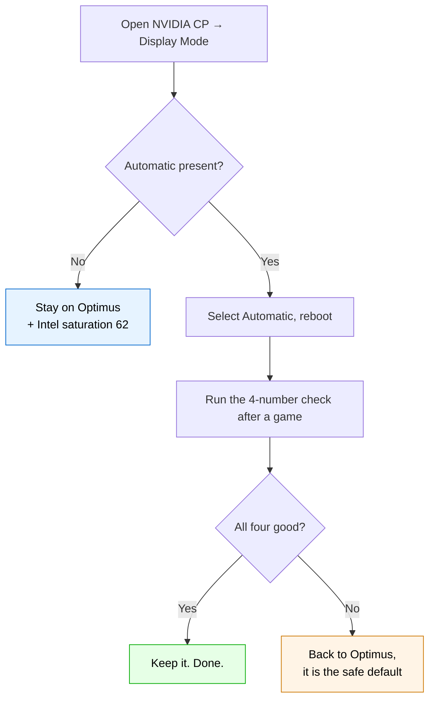

# 🎯 The plan: colour + brightness + G-Sync + smoothness

> Four things the owner wants at the same time. Three of them are owned by whichever
> GPU drives the panel — so the whole problem is *who owns the panel, and when*.

---

## What owns what

| Resource | Owner | Available when |
|---|---|---|
| **Brightness 0–100** | ACPI backlight on the **Intel** GPU device → EC | panel on Intel, **or** the stale Intel path still enumerated |
| **NVIDIA colour** (saturation 125) | the **scanning** GPU's display pipeline | panel on NVIDIA |
| **G-SYNC / VRR** | the **scanning** GPU | panel on NVIDIA |
| **Smooth composition** | needs exactly **one** active path | one active monitor device |

That is the entire system. Everything else is a consequence.

---

## The three configurations

| | Brightness | NVIDIA colour | G-Sync | Smooth | FPS cost |
|---|---|---|---|---|---|
| **Optimus** (current) | ✅ | ❌ (Intel 62 instead) | ❌ | ✅ | 0–5 % |
| **NVIDIA only** | ❌ (unless stale path) | ✅ | ✅ | ❌ when the stale path is present | 0 % |
| **Automatic** (DDS) | ⚠️ during games only | ✅ in games | ✅ in games | ✅ | 0–5 % |

**Automatic — Dynamic Display Switching, a.k.a. Advanced Optimus — is the only
configuration that can give all four**, because it moves the panel to whoever needs it:
NVIDIA for the game, Intel for the desktop.

---

## Does this laptop have DDS?

Three independent hints, all pointing yes, none of them conclusive on their own:

| Evidence | Where it came from |
|---|---|
| Dell's own spec text for the G15 5530 panel reads **"NVIDIA G-SYNC + DDS Display"** | product listing / owner reports |
| `ACPI\NVDA0820\NPCF` — *NVIDIA Platform Controllers and Framework* — present and **OK** | this machine |
| `ParadeMuxEdpLinkRateDataReloadTrigger = 1` on the Intel display adapter | this machine (the Parade eDP MUX) |

NVPCF + a Parade MUX is exactly the hardware pair Advanced Optimus is built on.

**The decisive check is one look at a UI page:**

> NVIDIA Control Panel → **Display** → **Display Mode**
>
> - three options — `Optimus` / **`Automatic`** / `NVIDIA GPU only` → **DDS is present**
> - two options — `Optimus` / `NVIDIA GPU only` → DDS is not exposed on this unit

---

## The algorithm



### Step 1 — check for Automatic
One look at the page above. Nothing to install, nothing to change.

### Step 2 — enable it
Select **Automatic**, apply, reboot if it asks.

### Step 3 — verify with four numbers
After playing a game and quitting it:

```powershell
# 1. who owns the panel right now (should be back on Intel after the game closes)
nvidia-smi --query-gpu=display_active --format=csv,noheader

# 2. one active monitor (2 = duplicate path created by the switch)
(Get-PnpDevice -Class Monitor | Where-Object Status -eq 'OK' | Measure-Object).Count

# 3. compositor idle (should be under 3%)
$p1=(Get-Process dwm).CPU; Start-Sleep 10; $p2=(Get-Process dwm).CPU
"{0}%" -f [math]::Round(($p2-$p1)/10*100,1)

# 4. brightness interface present
(Get-CimInstance -Namespace root\wmi -ClassName WmiMonitorBrightness | Measure-Object).Count
```

| Result | Meaning |
|---|---|
| 1 / 1 / <3 % / 1 | **Automatic works.** Keep it. |
| 1 / **2** / **30 %+** / 1 | the duplicate path came back with the switch → back to Optimus |
| 1 / 1 / <3 % / **0** | brightness did not return after the game → back to Optimus |

### Step 4 — roll back if needed
NVIDIA CP → Display Mode → **Optimus**. No registry changes were made, nothing to undo.

---

## Known trade-offs of Automatic

- **Brightness during games.** While the panel is on the NVIDIA GPU, the ACPI backlight
  handle is gone again (the same root cause as everywhere else in this repo). Set your
  brightness *before* launching, and it stays for the session.
- **A brief black flash** each time the panel moves. That is the MUX switching, not a bug.
- **DRM / HDCP** re-handshakes on every switch. Expect a short blink in Netflix or Prime
  Video; reload the tab if playback stalls. No evidence that protected playback breaks
  permanently — the protected path is inside the GPU that is scanning out, and both GPUs
  support it.

---

## If Automatic is not available

Then Optimus + Intel saturation ≈ 62 is the best available combination: brightness,
smoothness, and a colour match to NVIDIA's 125 %. The only real loss is G-Sync — and note
that this panel's EDID advertises **no adaptive-sync block** on either display path, so
G-Sync may never have been genuinely active here. Verify in NVIDIA CP: if
*Set up G-SYNC* never offered this panel as G-SYNC Compatible, there was nothing to lose.

The 0–5 % frame-rate cost of the extra copy is real but small; the 360 Hz panel is the
far bigger factor in how games feel.

---

## Why this is the honest answer

There is no registry key, driver option or script that makes one GPU own the panel and
the other own the backlight at the same time. The panel has exactly one owner at any
moment, and brightness, colour, sync and composition all follow that owner. The only
mechanism that changes owners *per application* is DDS — which is why the whole plan
hinges on whether that one page shows three options or two.
